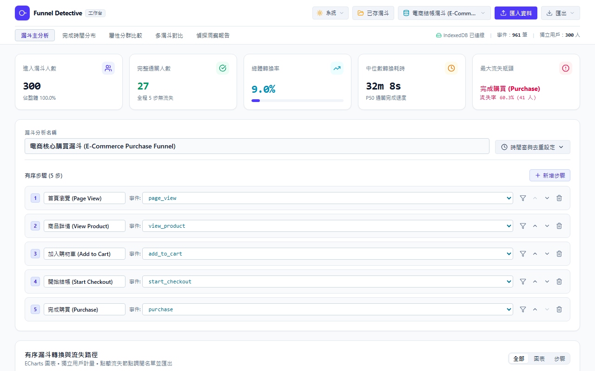

# Funnel Detective

[繁體中文](README.zh-TW.md) · **English**

> **Pure Frontend Interactive Event Conversion Funnel Studio**, 100% in-browser sandbox computation with strict deduplication and zero server data transfer.

<p align="center">
  
</p>

<p align="center">
  <a href="https://github.com/ReiKama414/funnel-detective">GitHub</a> ·
  <a href="https://reikama414.vercel.app/">Portfolio</a> ·
  <a href="#key-highlights">Highlights</a> ·
  <a href="#getting-started">Getting Started</a> ·
  <a href="#testing--validation">Validation</a> ·
  <a href="#license">License</a>
</p>

---

## Key Highlights

- **Pure In-Browser Sandbox Computation** — All event parsing, sequential path matching, window boundary checks, and conversion metric computations execute entirely on the client side with zero server dependencies or network transmission.
- **Strict Deduplication Architecture** — Mathematical set guarantees ensure each unique user is counted at most once per funnel step, eliminating counting inflation from duplicate clicks or repeated visits.
- **Monotonic Sequence & Window Boundaries** — Enforces strictly non-decreasing timestamps ($T_1 \le T_2 \le \dots \le T_k$) across steps, supporting both total window (from origin) and step-to-step interval modes.
- **Full Completion Time Distribution** — Precise R-7 linear interpolation percentiles (P50, P75, P90, P95) and Freedman-Diaconis adaptive binning histogram to distinguish fast conversions from long-tail hesitation.
- **Multi-Dimensional Property Segmentation** — Dissect funnels across dimensions such as device type, traffic source, or geographic region, with automated champion segment identification.
- **Multi-Funnel Parallel Comparison** — Side-by-side contrast of conversion performance under different time windows (e.g., 24 hours vs. 7 days), filter conditions, or deduplication rules, complete with delta ($\Delta$) metrics and diagnostic notes.
- **Automated Detective Diagnostics** — Built-in heuristic engine automatically flags critical drop-off choke points and transition latency bottlenecks with actionable optimization recommendations.
- **Audience Cohort Inspection & Export** — One-click inspection of dropped or converted user ID cohorts with instant CSV downloads, JSON analytical report exports, and chart PNG generation.
- **Responsive Design & Dual Theme** — Support for System, Light, and Dark modes across 9 distinct viewports (320px to 1920px), engineered with a strict Zero-Overlap Document Flow layout.
- **IndexedDB Offline Persistence** — Browser-native storage engine automatically persists custom datasets, configured funnels, and exported cohorts, enabling seamless continuation across browser restarts.

---

## Built-in Datasets

The studio comes preloaded with three real-world datasets, while also supporting custom CSV and JSON drag-and-drop ingestion:

| Dataset Name | Specs | Key Attributes | Analytical Focus |
| :--- | :--- | :--- | :--- |
| E-Commerce Checkout Funnel | 850 events · 310 users | Page View, View Item, Add to Cart, Initiate Checkout, Purchase · Device, Country, Amount | Choke point between Cart and Checkout, mobile checkout drop-off, high-value cart hesitation |
| SaaS User Onboarding & Activation | 620 events · 240 users | Sign Up, Verify Email, Create Project, Invite Team, Upgrade Plan · Plan Tier, Referrer | Team invite bottleneck, trial-to-paid median latency, enterprise onboarding efficiency |
| Mobile App Trial & Subscription | 540 events · 190 users | Install, Open App, Complete Tutorial, Enable Push, Subscribe · OS, Acquisition Channel | Tutorial abandon rate, push notification opt-in lift, organic vs. paid acquisition retention |

---

## Mathematical Precision Guarantees

Every analytical algorithm is verified via independent unit tests (100% pass rate) to guarantee mathematical consistency with raw source events:

- **Strict Deduplication Cohort Set**:
  $$\text{UserCohort}_k = \{ u \in \mathcal{U} \mid \exists (e_1, \dots, e_k) \text{ satisfying } T_1 \le T_2 \le \dots \le T_k \land \Delta T \le W \}$$
- **Overall Conversion Rate from Start**:
  $$CR_{1 \to k} = \frac{|\text{UserCohort}_k|}{|\text{UserCohort}_1|} \times 100\% \quad (|\text{UserCohort}_1| > 0)$$
- **Step-to-Step Conversion Rate**:
  $$CR_{k-1 \to k} = \frac{|\text{UserCohort}_k|}{|\text{UserCohort}_{k-1}|} \times 100\%$$
- **Drop-off Rate & Count**:
  $$\text{DropCount}_k = |\text{UserCohort}_{k-1}| - |\text{UserCohort}_k|, \quad DR_k = \frac{\text{DropCount}_k}{|\text{UserCohort}_{k-1}|} \times 100\%$$
- **Conversion Window Constraints**:
  - From First Step: $T_k - T_1 \le W$
  - Step-to-Step Interval: $T_i - T_{i-1} \le W \quad (\forall i \in [2, k])$
- **Quantiles**: Implemented via the standard R-7 linear interpolation method, ensuring $P50 \equiv \text{Median}$:
  $$Q(p) = x_{\lfloor h \rfloor} + (h - \lfloor h \rfloor)(x_{\lceil h \rceil} - x_{\lfloor h \rfloor}), \quad h = (n - 1)p + 1$$
- **Freedman-Diaconis Adaptive Binning**:
  $$h = 2 \cdot \text{IQR} \cdot n^{-1/3}, \quad k = \left\lceil \frac{\max(T) - \min(T)}{h} \right\rceil$$

---

## Tech Stack

| Layer | Technology | Purpose |
| :--- | :--- | :--- |
| Frontend Framework | React 19 · TypeScript | Component modularity and strict type-safety guarantees |
| Build Tool | Vite | Ultra-fast local development server and optimized Rollup production bundling |
| Styling & Theme | Tailwind CSS | High-density workbench aesthetic with unified dark/light design tokens |
| Data Visualization | Apache ECharts | Responsive charts, containLabel layout isolation, and 2x PNG rendering |
| Local Persistence | Native IndexedDB (`idb`) | Multi-dataset persistence, saved funnels, and exported cohort storage |
| Data Ingestion | PapaParse | High-performance RFC-4180 streaming CSV parser with timestamp auto-mapping |
| UI Iconography | Lucide Icons | Minimal, pixel-crisp geometric vector icons |
| Automated Testing | Playwright · Vitest | E2E user flows, 9-viewport RWD, theme switching, and statistical precision tests |

---

## Getting Started

### Prerequisites

Node.js 20+ and npm.

### Installation & Development

```bash
# 1. Install dependencies
npm install

# 2. Start local development server
npm run dev
```

Open the printed local URL (default: `http://localhost:5173`) in your browser.

### Production Build & Preview

```bash
# Execute TypeScript checking and production bundle
npm run build

# Preview production build locally
npm run preview
```

---

## User Workflow

1. **Dataset Loading**: Click the dataset switcher in the top bar to choose between 3 preloaded datasets, drag-and-drop custom CSV/JSON files, or paste clipboard contents.
2. **Funnel Sequence Configuration**: Add, reorder, or remove steps, customize step display names, and specify optional property filter conditions per step.
3. **Conversion Window & Deduplication**: Tune the conversion time window (minutes, hours, days) and choose between First Touch (strict deduplication) or Best Touch modes.
4. **Retention Visualization**: Inspect stage-by-stage user retention gauges and conversion rates in the "漏斗主分析" (Main Funnel) view.
5. **Time Distribution Exploration**: Switch to "完成時間分布" (Time Distribution) to inspect P50, P75, P90, and P95 percentiles, duration histograms, and transition latencies.
6. **Property Segmentation**: Select target dimensions (e.g., device, country) in "屬性分群比較" to review grouped retention charts, champion segment cards, and comparative tables.
7. **Parallel Funnel Comparison**: Contrast conversion curves across different time windows or customer segments in "多漏斗對比" with automated delta ($\Delta$) summaries.
8. **Cohort Inspection & Export**: Click "查看流失名單" on any transition step to browse user IDs, download cohort CSVs, or export metric CSVs and JSON reports from the header.

---

## Testing & Validation

The project undergoes automated validation covering math accuracy and browser workflows (41 automated tests):

```bash
# Run statistical accuracy unit tests
npm test

# Run full Playwright browser suite
npm run test:e2e
```

Validation Checklist:

- **Mathematical Precision**: Strict user deduplication, monotonic step ordering, conversion window filtering, R-7 percentiles, and Freedman-Diaconis binning verified to 100% numerical accuracy.
- **Interactive Workflows**: Step editing, tab switching, cohort modal inspection, custom CSV parsing, and IndexedDB persistence.
- **RWD Verification**: Zero horizontal page overflow verified across 320px, 375px, 390px, 430px, 768px, 1024px, 1280px, 1440px, and 1920px viewports.
- **Dual Theme Support**: System preference detection, light/dark mode toggling, and localStorage persistence.
- **Zero-Overlap Architecture**: Non-intersecting bounding box verification between titles, statistics, chart canvases, and legends under 100% and 200% zoom levels.

---

## Known Limitations

> **Note:**
> 1. All calculations execute on the browser's single thread; datasets under 50,000 rows or 20MB are recommended for optimal 60fps interaction.
> 2. Offline storage relies on the browser's IndexedDB storage quota. Incognito sessions will clear persisted datasets upon closing the window.
> 3. Uploaded CSVs should be UTF-8 encoded; please convert legacy Big5 CSVs before loading.

---

## License

Copyright (c) 2026 ReiKama414. All rights reserved.

This software and its source code are provided solely for personal viewing and learning purposes.
No permission is granted to use, copy, modify, distribute, sublicense, or incorporate this software
or any part of it into other projects, whether for commercial or non-commercial purposes,
without the express written consent of the copyright holder.

- [GitHub](https://github.com/ReiKama414/funnel-detective)
- [Portfolio](https://reikama414.vercel.app/)
- [Full License](./LICENSE)

---

<sub>Funnel Detective · Pure Frontend Interactive Event Conversion Funnel Studio · ReiKama414</sub>
