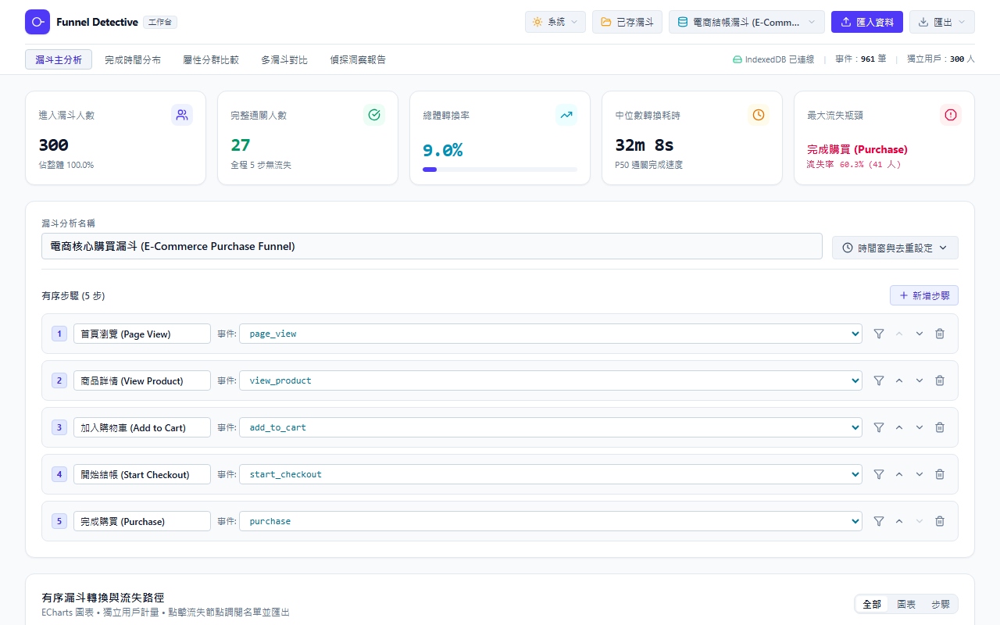

# Funnel Detective

**繁體中文** · [English](README.md)

> **純前端有序事件漏斗轉換分析工作台**，100% 瀏覽器本地沙盒運算，嚴格獨立使用者防重複計量

<p align="center">
  
</p>

<p align="center">
  <a href="https://github.com/ReiKama414/funnel-detective">GitHub</a> ·
  <a href="https://reikama414.vercel.app/">個人網站</a> ·
  <a href="#核心亮點">核心亮點</a> ·
  <a href="#快速開始">快速開始</a> ·
  <a href="#驗證與測試">驗證與測試</a> ·
  <a href="#license--權限">授權</a>
</p>

---

## 核心亮點

- **純瀏覽器本地沙盒運算** — 所有事件解析、有序路徑匹配、時間窗判定與指標彙總皆在客戶端本地執行，完全零伺服器資料傳輸與網路相依
- **嚴格防重複計量核心** — 基於數學集合論保證每位獨立使用者在各步驟最多計入 1 次，徹底杜絕重複點擊或多重回訪造成的計量失真
- **有序時序與時間窗邊界** — 嚴格驗證事件戳記單調遞增（$T_1 \le T_2 \le \dots \le T_k$），支援起點總時間與相鄰步驟雙重時間窗模式
- **全漏斗完成時間分布** — 提供 R-7 線性內插分位數（P50、P75、P90、P95）與 Freedman-Diaconis 自適應直方圖，辨識快速決策群體與長尾猶豫客群
- **多維度屬性分群樞紐** — 支援依裝置類型、流量來源、地理區域等維度自動拆解漏斗，快速鎖定轉換表現最優客群
- **多漏斗平行對照比較** — 橫向對比不同轉換窗口（如 24 小時 vs 7 天）、不同篩選條件或去重模式，產出指標差異 ($\Delta$) 與自然語言診斷
- **智慧偵探自動診斷報告** — 演算法自動巡檢流失最劇烈的斷點步驟與耗時最長的滯留環節，即時給予具體改善建議
- **受眾名單調閱與匯出** — 點擊各步驟節點即刻調閱流失受眾 User ID 清單，真實現地匯出 CSV、JSON 報告與圖表圖片
- **全響應式與黑白雙主題** — 支援跟隨系統、淺色與深色三種模態，適配 320px 至 1920px 九種螢幕尺寸，全域採用無重疊（Zero-Overlap）獨立 Document Flow 排版架構
- **IndexedDB 離線持久化儲存** — 內建瀏覽器原生資料庫儲存，自訂資料集、漏斗設定與歷史名單自動同步保存，重新整理或重開頁面隨時接續工作

---

## 內建實戰資料集

系統預載三組實戰資料集，亦支援隨時拖曳匯入自訂 CSV 或 JSON：

| 資料集名稱 | 規格 | 特徵屬性 | 探索重點 |
| :--- | :--- | :--- | :--- |
| 電商零售購買結帳漏斗 | 850 筆事件 · 310 位用戶 | 首頁瀏覽、檢視商品、加入購物車、發起結帳、完成購買 · 裝置、地區、金額 | 加入購物車至發起結帳之關鍵流失斷點、行動裝置結帳率、高客單價猶豫期 |
| SaaS 軟體用戶啟用啟用 | 620 筆事件 · 240 位用戶 | 註冊帳號、驗證信箱、建立專案、邀請成員、升級方案 · 方案等級、推薦來源 | 團隊邀請步驟瓶頸、付費轉換中位耗時、企業方案啟用漏斗 |
| 行動 App 新客試用流程 | 540 筆事件 · 190 位用戶 | 下載安裝、開啟應用、完成新手導覽、開啟推播、訂閱會員 · 作業系統、行銷管道 | 新手導覽跳出率、推播許可轉換差異、自然流量與廣告投放留存比較 |

---

## 統計數學公式保證

所有演算法皆經過獨立單元測試驗證（100% 通過），確保各項分析結果與原始事件完全一致：

- **單一使用者防重算集合 (Strict Deduplication Set)**：
  $$\text{UserCohort}_k = \{ u \in \mathcal{U} \mid \exists (e_1, \dots, e_k) \text{ 滿足 } T_1 \le T_2 \le \dots \le T_k \land \Delta T \le W \}$$
- **總體轉換率 (Overall Conversion Rate from Start)**：
  $$CR_{1 \to k} = \frac{|\text{UserCohort}_k|}{|\text{UserCohort}_1|} \times 100\% \quad (|\text{UserCohort}_1| > 0)$$
- **前步轉換率 (Step-to-Step Conversion Rate)**：
  $$CR_{k-1 \to k} = \frac{|\text{UserCohort}_k|}{|\text{UserCohort}_{k-1}|} \times 100\%$$
- **單步流失率與流失人數 (Drop-off Rate & Count)**：
  $$\text{DropCount}_k = |\text{UserCohort}_{k-1}| - |\text{UserCohort}_k|, \quad DR_k = \frac{\text{DropCount}_k}{|\text{UserCohort}_{k-1}|} \times 100\%$$
- **時間窗約束 (Conversion Window Boundary)**：
  - 起點起算模式：$T_k - T_1 \le W$
  - 相鄰步驟模式：$T_i - T_{i-1} \le W \quad (\forall i \in [2, k])$
- **四分位數 (Quantiles)**：採用 R-7 線性內插法，保證 $P50$ 恆等於中位數
  $$Q(p) = x_{\lfloor h \rfloor} + (h - \lfloor h \rfloor)(x_{\lceil h \rceil} - x_{\lfloor h \rfloor}), \quad h = (n - 1)p + 1$$
- **Freedman-Diaconis 自適應分箱 (Adaptive Time Binning)**：
  $$h = 2 \cdot \text{IQR} \cdot n^{-1/3}, \quad k = \left\lceil \frac{\max(T) - \min(T)}{h} \right\rceil$$

---

## 技術棧

| 層級 | 技術選型 | 用途說明 |
| :--- | :--- | :--- |
| 前端框架 | React 19 · TypeScript | 高效元件化開發與嚴格型別安全檢查 |
| 建置工具 | Vite | 極速本機開發伺服器與 Rollup 生產打包 |
| 樣式管理 | Tailwind CSS | 高資訊密度專業工作台風格與雙主題規範 |
| 圖表繪製 | Apache ECharts | 自適應階段留存量規、時間直方圖與分群長條圖 |
| 本地儲存 | 原生 IndexedDB (`idb`) | 離線持久化儲存自訂資料集、漏斗配置與歷史名單 |
| 資料解析 | PapaParse | 瀏覽器端高效 CSV 串流解析、時間戳格式識別與異常略過判定 |
| 圖示庫 | Lucide Icons | 統一、精緻的幾何向量圖示 |
| 自動化測試 | Playwright · Vitest | E2E 互動、RWD 九尺寸、雙主題切換與數學精度測試 |

---

## 快速開始

### 系統需求

需要 Node.js 20+ 與 npm

### 安裝與啟動

```bash
# 1. 安裝依賴
npm install

# 2. 啟動本機開發伺服器
npm run dev
```

啟動後於瀏覽器開啟提示之本機網址（預設為 `http://localhost:5173`）

### 生產建置與預覽

```bash
# 執行 TypeScript 型別檢查與生產打包
npm run build

# 本機預覽生產版本
npm run preview
```

---

## 操作流程

1. **載入或切換資料集**：點擊頂部資料集選單切換 3 組實戰資料，或點擊「匯入資料」拖曳上傳自訂 CSV/JSON 並確認欄位對應
2. **配置有序漏斗步驟**：於步驟編輯區新增步驟、自訂名稱、上下調整時序順序，或附加單步屬性篩選條件
3. **設定時間窗與去重規則**：展開進階設定，自訂轉換時間窗數值（分鐘、小時、天）與去重模式（首次觸發 vs 最佳路徑）
4. **檢視 ECharts 留存量規**：在「漏斗主分析」觀察視覺化量規長條與各步驟轉化率，點擊卡片調閱詳細數據
5. **探勘完成時間分布**：在「完成時間分布」檢視 P50/P75/P90/P95 分位數指標卡、時間區間直方圖與相鄰步驟中位耗時
6. **屬性分群平行對比**：在「屬性分群比較」選取裝置或地區維度，檢視跨群體長條圖、最優客群 Champion 卡與指標詳表
7. **多漏斗橫向對照**：在「多漏斗對比」切換長短窗口或客群對照，即時查看轉化差值與自動產出的比較洞察摘要
8. **受眾調閱與資料匯出**：點擊任一步驟「查看流失名單」調閱 User ID 並匯出 CSV，或由頂部匯出指標 CSV、JSON 與持久化備份

---

## 驗證與測試

本專案經過嚴格計算精度與自動化瀏覽器驗收（共 41 項測試全部通過）：

```bash
# 執行核心計量算法單元測試 (Vitest)
npm test

# 執行全套 Playwright 瀏覽器測試
npm run test:e2e
```

測試驗證清單：

- **統計與計量精度**：嚴格去重集合運算、單調時序驗證、轉換時間窗過濾、R-7 分位數與直方圖分箱 100% 精度
- **互動流程**：步驟動態編輯、分頁視圖切換、流失名單調閱、自訂 CSV 解析匯入與 IndexedDB 本地保存
- **全裝置 RWD**：驗證 320px、375px、390px、430px、768px、1024px、1280px、1440px、1920px 九種解析度，無水平溢出
- **黑白雙主題**：跟隨系統偏好、淺色模式與深色模式之即時切換與持久化
- **Zero-Overlap 排版完整性**：卡片標題、統計數值、圖表畫布與圖例邊界不相交驗收，支援瀏覽器 200% 縮放

---

## 已知限制

> **提醒：**
> 1. 所有計算皆於使用者瀏覽器單執行緒即時執行，建議單次匯入資料集規模控制在 50,000 列或 20MB 以內，以維持最流暢之互動體驗
> 2. 本地資料持久化依賴瀏覽器 IndexedDB 儲存配額；若於無痕視窗（Incognito）操作，關閉瀏覽器後儲存內容將自動抹除
> 3. 匯入之 CSV 建議使用 UTF-8 編碼，若為舊版 Excel 匯出之 Big5 編碼請先轉存為 UTF-8

---

## License / 權限

Copyright (c) 2026 ReiKama414. All rights reserved.

本專案僅供個人瀏覽與學習。未經著作權人書面同意，不得使用、複製、修改、散布或併入其他專案（含非商業用途）

- [GitHub](https://github.com/ReiKama414/funnel-detective)
- [個人網站](https://reikama414.vercel.app/)
- [授權全文](./LICENSE)

---

<sub>Funnel Detective · 純前端有序事件漏斗轉換分析工作台 · ReiKama414</sub>
